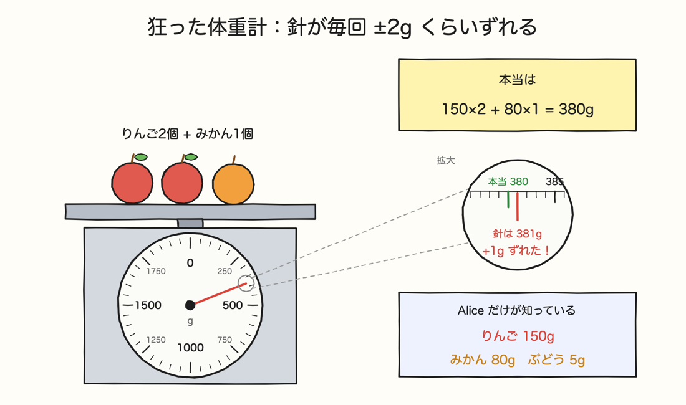
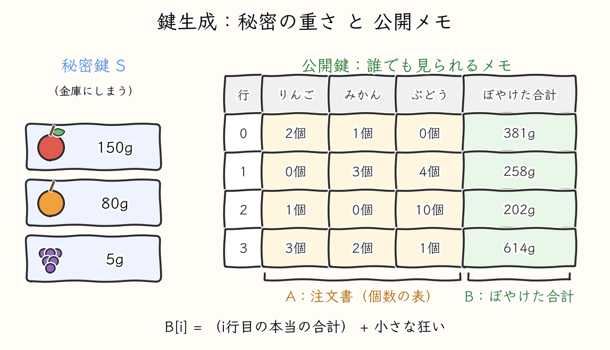
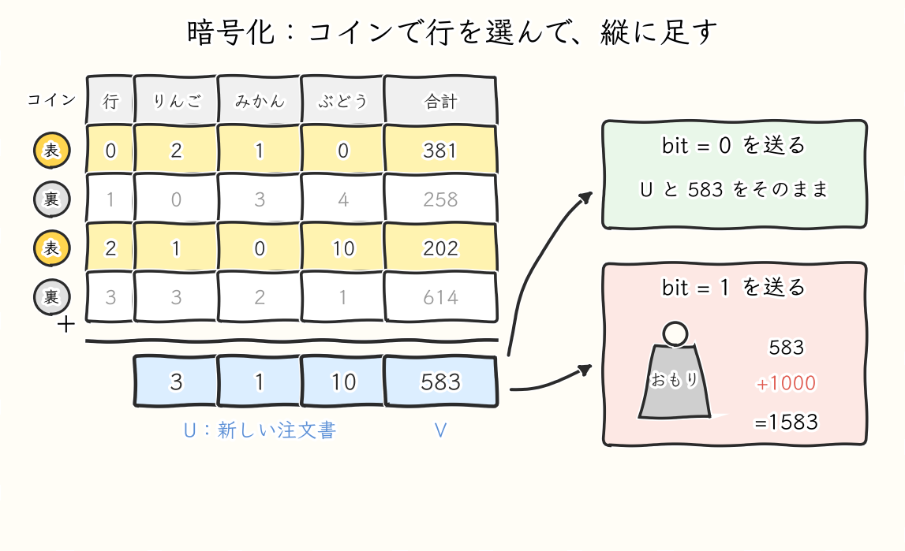
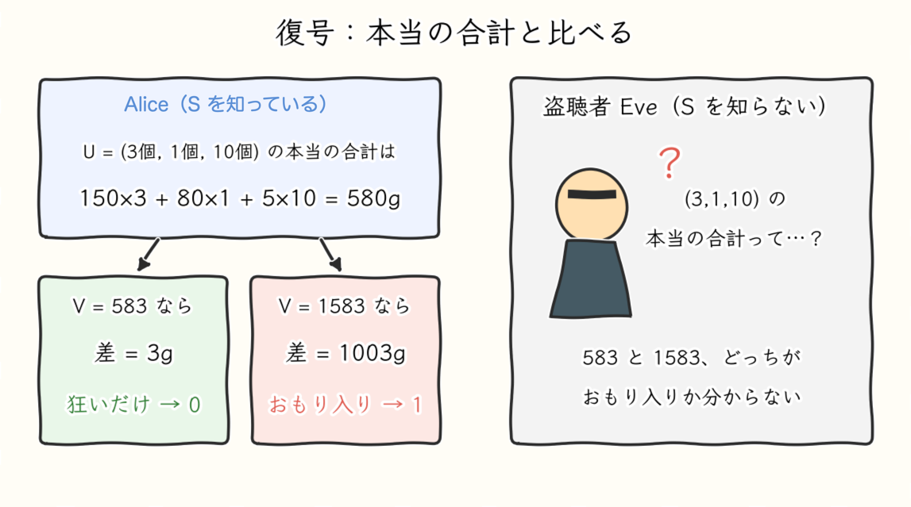
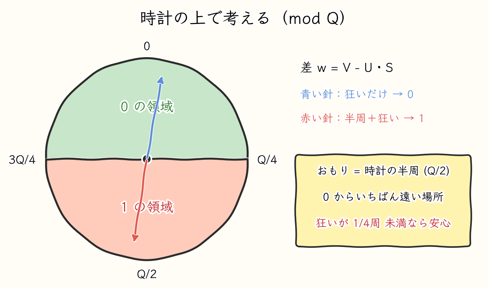

# 格子暗号（LWE）

[`toy/`](toy/) は、LWE で **1ビットだけを暗号化・復号するtoylwe** である。登場人物は、秘密鍵を持つ果物屋の **Alice**、Alice にビットを送る客の **Bob**、盗聴者の **Eve**。

---

## 0. LWE 暗号の定義と定理

**パラメータ**：Q（法）、N（秘密の長さ）、M（公開鍵の行数）、誤差の上限 E（各誤差は −E〜+E）

**鍵生成**（Alice）

$$
S \leftarrow \mathbb{Z}_Q^{N},\quad A \leftarrow \mathbb{Z}_Q^{M\times N},\quad e \leftarrow \{-E,\dots,E\}^{M},\quad B = A S + e \bmod Q
$$

公開鍵は $`(A, B)`$、秘密鍵は $`S`$。

**暗号化**（Bob、送るビット $`\mu \in \{0,1\}`$）

$$
r \leftarrow \{0,1\}^{M},\quad U = A^{\top} r \bmod Q,\quad V = B^{\top} r + \mu \left\lfloor \tfrac{Q}{2} \right\rfloor \bmod Q
$$

暗号文は $`(U, V)`$。

**復号**（Alice）

$$
w = V - \langle U, S \rangle \bmod Q,\qquad
\mathrm{Dec}(U,V) =
\begin{cases}
1 & \tfrac{Q}{4} < w < \tfrac{3Q}{4} \\
0 & \text{otherwise}
\end{cases}
$$

**定理（正しさ）**：$`M E < Q/4`$ なら、復号は必ず元のビット $`\mu`$ を返す。

**証明**：$`B = AS + e`$ を代入すると、

$$
w = (AS + e)^{\top} r + \mu \left\lfloor \tfrac{Q}{2} \right\rfloor - (A^{\top} r)^{\top} S
  = e^{\top} r + \mu \left\lfloor \tfrac{Q}{2} \right\rfloor \pmod Q
$$

$`r`$ の成分は 0 か 1 なので $`|e^{\top} r| \le M E < Q/4`$。よって $`\mu = 0`$ なら $`w`$ は 0 の近く、$`\mu = 1`$ なら $`Q/2`$ の近くに収まり、判定は誤らない。∎

**定理（安全性）**：LWE 仮定（$`(A, AS+e)`$ は一様ランダムな $`(A, B)`$ と見分けがつかない）が成り立ち、さらに

$$
M \gtrsim (N + 1) \log_2 Q
$$

なら、$`S`$ を知らない Eve には $`(U, V)`$ から $`\mu`$ はわからない。

**証明の流れ**：

1. LWE 仮定より、B を一様ランダムな値に置き換えても Eve には区別できない
2. r の候補 $`2^M`$ 通りが、$`(U, B^{\top} r)`$ の取りうる値 $`Q^{N+1}`$ 通りより十分多ければ、同じ U になる r が大量にある。このとき $`(U, B^{\top} r)`$ は一様ランダムに近く、V の中の $`\mu \lfloor Q/2 \rfloor`$ は覆い隠される（leftover hash lemma）

**M が少ないと破れる**：条件 2 が崩れると、U から r が一つに決まる。特に $`M \le N`$ なら、$`U = A^{\top} r`$ は「式 N 本・未知数 M 個」の普通の連立方程式で、掃き出し法で r が求まる。r がわかれば、誤差は公開されている B の中に入っているので、

$$
V - B^{\top} r = \mu \left\lfloor \tfrac{Q}{2} \right\rfloor
$$

となり、S なしで $`\mu`$ がそのまま読める。LWE 問題（B から S を求める）が難しくても、M の選び方を誤れば暗号としては破れる。

**toy のパラメータ**：Q = 3329、N = 16、M = 32、E = 2。正しさの条件 $`ME = 64 < Q/4 \approx 832`$ は満たす。一方、安全性の条件 $`(N+1)\log_2 Q \approx 199`$ には M = 32 では足りない（r は $`2^{32}`$ 通りの総当たりで求まる）。toy は仕組みを理解するためのもので、安全ではない。

---

## 1. 狂った体重計：LWE 問題



- **S**：果物1個ずつの本当の重さ。Alice だけが知っている
- **A の1行**：量る果物の個数の組み合わせ（例：りんご2・みかん1・ぶどう0）
- **e**：体重計の狂い（±2g）
- **B の1行**：体重計の針が指す値 = 本当の合計 + 狂い（380g → 381g）

りんご・みかん・ぶどうの重さを $`x, y, z`$ とする（図2の 0〜2 行目）。

**誤差なし**：普通の連立方程式。すぐ解ける。

$$
\begin{cases}
2x + y = 380 \\
3y + 4z = 260 \\
x + 10z = 200
\end{cases}
\quad\Longrightarrow\quad (x, y, z) = (150,\ 80,\ 5)
$$

**誤差あり**：右辺が 1〜2g ずれただけ。

$$
\begin{cases}
2x + y = 381 \\
3y + 4z = 258 \\
x + 10z = 202
\end{cases}
\quad\Longrightarrow\quad (x, y, z) = (463,\ 2784,\ 2970) \pmod{3329}
$$

数g の狂いで、答えは本当の重さとまったく違う値になる。式を足し引きするたびに誤差も一緒に膨らむためである。

「誤差入りの式 $`B = AS + e`$ から S を求めよ」というのが LWE 問題。

---

## 2. 鍵生成：秘密の重さと公開メモ



- **秘密鍵 S**：本当の重さの一覧。Alice が金庫にしまう
- **公開鍵 (A, B)**：組み合わせ A と、その量り値 B を M 行書いたメモ。誰でも見られる

例：0行目は 150×2 + 80×1 + 5×0 = 380g、狂い e = +1 なので B = 381g。

---

## 3. 暗号化：行を混ぜて、おもりを足す



- **r**：Bob が各行に投げるコイン（表 = 1、裏 = 0）
- **U** = 表の行の A を縦に足したもの（新しい組み合わせ）
- **V** = 表の行の B を縦に足したもの。1 を送るときは、さらにおもり Q/2 を足す

r は Bob しか知らないので、同じビットでも暗号文は毎回変わる。

---

## 4. 復号：本当の合計と比べる



- **U・S**：組み合わせ U の本当の合計。S を知る Alice だけが計算できる
- **w = V − U・S**：狂いだけなら 0、おもり入りなら 1

Eve は S を知らないので U・S を計算できず、V におもりが入っているか判断できない。

---

## 5. 時計の上で計算する理由（mod Q）



- **mod Q**：Q を超えたら 0 に戻る。V の大きさからおもりの有無がわからなくなる
- **おもり Q/2**：時計の半周。0 から一番遠いので、0 と 1 を一番見分けやすい
- **判定**：w が上半分（0 の近く）なら 0、下半分（Q/2 の近く）なら 1
- **条件**：狂いの合計が Q/4 未満なら必ず正しく読める（0章の定理）

---

## 6. mapping

| たとえ | コード | 形 |
|---|---|---|
| 果物の種類数 | `N`（=16） | 数 |
| メモの行数 | `M`（=32） | 数 |
| 時計の大きさ | `Q`（=3329） | 数 |
| 果物ごとの本当の重さ | `sk.S[j]` | 長さ N のベクトル |
| i 行目の注文書（j 番目の果物の個数） | `pk.A[i][j]` | M 行 × N 列の表 |
| i 行目のぼやけた合計 | `pk.B[i]` | 長さ M のベクトル |
| 体重計の狂い | `smallError()` | -2〜+2 |
| Bob の新しい注文書 | `ct.U[j]` | 長さ N のベクトル |
| その合計（＋おもり） | `ct.V` | 数 1つ |
| おもり | `Q/2` | 数 |

実際のコードでは、個数も重さも 0〜3328 のランダムな数。「りんご2000個」のような変な注文書になるが、**表の形とやっていること（行を足す・本当の合計と比べる）は図の例と同じ**である。

## 実行方法

Need：Go 1.22^

```sh
go test ./toy/ -v                    # toy の全テストを実行
go test ./toy/ -run TestKeyGen -v    # 1つだけ実行
```